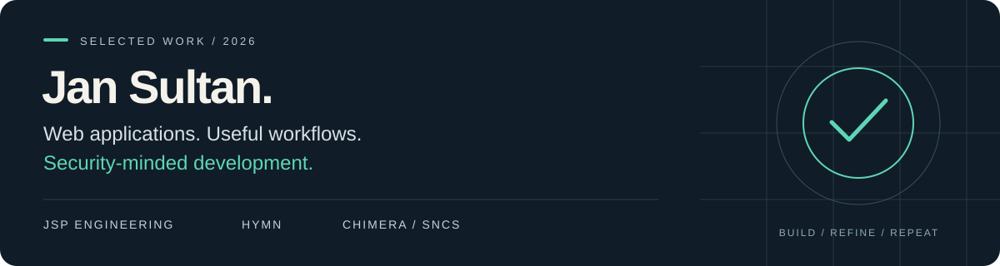

  

  <a href="https://jan-sultan.vercel.app">Portfolio</a> &nbsp; / &nbsp;
  <a href="https://www.linkedin.com/in/jansultan0210">LinkedIn</a> &nbsp; / &nbsp;
  <a href="https://tryhackme.com/p/jgsultan">TryHackMe</a>

I'm **Jan Samuel Sultan**, a Computer Science student at **Asia Pacific College**, specializing in **Cybersecurity and Forensics**. I build web applications for businesses, communities, and schools, with an interest in AI-assisted workflows and application security.

## Featured work

### 01 / JSP Engineering Services
**Engineering services website & Energy AI interface**

A responsive website that brings an engineering firm's services, project information, and consultation workflow into one place. Its Energy AI desk presents a utility-bill intake interface for understanding consumption and exploring solar scenarios.

**My work:** Freelance website development.  
**Built with:** React · TypeScript · Tailwind CSS · Gemini API · Vercel

[Visit the website ↗](https://jsp-engineering.vercel.app)

---

### 02 / Hymn
**Song preparation & worship presentation workflow**

A shared workspace for song lyrics and scheduled setlists, connected to a desktop presenter. Browser-based OCR imports lyrics from images for review; a versioned sync API lets the presenter cache content for offline use.

**My work:** Web and desktop application development for a church workflow.  
**Built with:** Vue 3 · Node.js / Express · Turso · Tesseract.js · Tauri desktop client

[Explore the source ↗](https://github.com/achlys0165/hymn) · [Open the web app ↗](https://top-hymn.vercel.app) *(authorized account required)*

---

### 03 / Chimera — SNCS School Web App
**School information, learning resources & online enrollment**

A collaborative school website project for **Sto. Niño Catholic School Inc.** Public pages, downloadable learning resources, and enrollment forms connect the visitor experience to administrative workflows.

**My work:** Team development, including staff login and Academic Coordinator access on my contribution branch.  
**Built with:** Vue 3 · TypeScript · Node.js / Express · Supabase · Cloudflare Turnstile

[Explore my fork ↗](https://github.com/achlys0165/APC-2026-2027-T1-SF241-Grp2-Chimera---Redesign-and-Development-of-an-Interactive-School-Website-w) · [View my contribution branch ↗](https://github.com/achlys0165/APC-2026-2027-T1-SF241-Grp2-Chimera---Redesign-and-Development-of-an-Interactive-School-Website-w/tree/20261112_Jan_Login)

## Beyond the projects

I also explore **web exploitation, CTFs, networking, and automation**. My current toolkit includes JavaScript, TypeScript, Vue, Python, Supabase, Git, and Linux.

For project inquiries or opportunities, reach me on [LinkedIn](https://www.linkedin.com/in/jansultan0210).

Built around real workflows. Improved through practice.

